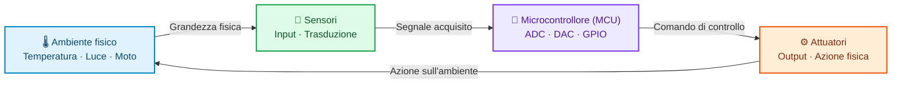

# 1. Panoramica su Sensori e Attuatori (Sensors & Actuators Overview)
I sistemi embedded interagiscono continuamente con l'ambiente fisico circostante attraverso due tipologie principali di dispositivi: **sensori** e **attuatori**.


## Sensore / Trasduttore (Sensor / Transducer)
#def Un sensore è un **dispositivo trasduttore** capace di misurare un determinato fenomeno fisico (es. temperatura, umidità, radiazioni, pressione, accelerazione) o di rilevare e quantificare una concentrazione chimica (es. presenza di gas o fumo).

**Funzione**: Fornisce una rappresentazione misurabile (solitamente sotto forma di grandezza elettrica come **tensione** o **corrente**) su una determinata scala o intervallo di misura.
**Classificazione Segnale in Uscita**:
- **Analogico**: La variazione elettrica prodotta in uscita è continua nel tempo. Per essere letta da una MCU, richiede un convertitore analogico-digitale (**ADC**).
- **Digitale**: Il segnale elettrico viene mappato direttamente su un insieme discreto di valori (es. livelli logici HIGH/LOW o protocolli seriali).
## Il Processo di Sensing (The Sensing Process)
Il processo di misurazione si articola in tre fasi fondamentali:

1. **Misurando / Grandezza Fisica**: Fenomeno reale (suono, movimento/accelerazione, reazione chimica, proteine/batteri).
2. **Trasduzione (Transduction)**: Conversione dell'energia del fenomeno fisico in un segnale intermedio.
3. **Uscita (Output)**: Generazione del segnale elettrico (tensione/corrente) o segnale ottico interpretabile dai sistemi di elaborazione.

## Attuatore (Actuator)
#def Dispositivo che produce un effetto fisico o meccanico misurabile sull'ambiente esterno (es. motori DC/stepper, servomotori, relè, elettrovalvole, LED, speaker).
- Possono essere pilotati in modalità analogica (tramite **DAC** o segnali emulati **PWM**) o digitale.
![[Pasted image 20261015113839.png]] _(schema del processo di sensing con grandezze fisiche, trasduzione e segnale di output)_
# 2. Principi Fisici di Funzionamento ed Esempio: Misurazione della Temperatura
I sensori si basano su leggi fisiche ben precise che legano la grandezza da misurare a una variazione elettrica misurabile.
### Esempio Pratico: Termoresistenza (RTD / Termistore)
Nelle termoresistenze (o termistori), il principio di funzionamento si basa sulla **variazione della resistività (**$\rho$**) in funzione della temperatura (**$T$**)**.

> [!NOTE] Relazione: Temperatura** $\rightarrow$ **Resistività** $\rightarrow$ **Tensione**

- **Formula della Resistenza Elettrica**: $$R = \rho(T) \cdot \frac{l}{S}$$ _(Dove_ $\rho$ _è la resistività del materiale,_ $l$ _la lunghezza del provino,_ $S$ _la sezione trasversale)_.
- **Effetto della Temperatura**: In molti conduttori e semiconduttori (es. RTD in Platino Pt100 o termistori PTC), **più alta è la temperatura, maggiore è la resistività del materiale** ($\uparrow T \implies \uparrow \rho \implies \uparrow R$).
- **Come si converte la variazione in un segnale di Tensione misurabile?** Per leggere la variazione di temperatura tramite un circuito elettronico o una MCU:
    1. Si inietta nella termoresistenza una **corrente di riferimento costante (**$I_{ref}$**)**.
    2. Per la Legge di Ohm ($V = I \cdot R$), la tensione letta ai capi della termoresistenza sarà: $$V_m(T) = I_{ref} \cdot R(T)$$
    3. Di conseguenza: **Una variazione del livello di temperatura** $\Delta T$ **produce una variazione della resistenza** $\Delta R$**, che si traduce direttamente in una variazione misurabile del livello di tensione** $\Delta V$!

```
Energia Termica (T)  -->  Variazione Resistività (ρ) e Resistenza (R)  -->  Variazione Tensione (Vm = Iref * R)
```

![[Pasted image 20261015114107.png]] _(circuito con generatore di corrente_ $I_{ref}$_, termoresistenza nel forno e lettura di_ $V_m$_)_
# 3. Grandezze Fisiche, Segnali, Campionamento e Quantizzazione
## Classificazione delle Grandezze Fisiche e dei Segnali:

- **Grandezze Continua**: Possono assumere qualsiasi valore reale all'interno di un intervallo (es. temperatura, distanza, velocità angolare di un motore).
- **Grandezze Discrete**: Possono assumere unicamente un insieme finito o numerabile di valori (es. senso di rotazione, numero di pezzi lavorati).
## Classificazione dei Segnali Discreti
![[Pasted image 20261015114439.png]]
L'informazione associata a una grandezza fisica viene veicolata sotto forma di **segnale**. I segnali discreti si dividono in due categorie principali:

1. **Segnali Logici (Logical Signals)**:
    - Possono assumere **soltanto due valori ammissibili** (HIGH/LOW, 1/0, $5\text{ V} / 0\text{ V}$).
    - _Esempi_: Rilevamento di presenza/assenza (sensore PIR), contatto aperto/chiuso di un pulsante.
2. **Segnali Codificati (Codified Signals)**:
    - Possono assumere **più di due valori discreti** per rappresentare un'informazione complessa o quantificata.
    - _Esempi_: Conteggio di oggetti passati su un nastro trasportatore, impulsi di rotazione di un **encoder angolare** per misurare l'angolo in gradi ($^\circ$).
## Campionamento del Segnale (Signal Sampling - $\Delta T$)

> [!NOTE] **Campionamento nel tempo (**$\Delta T$**)** Un fenomeno fisico reale varia in modo continuo nel tempo $t$. Tuttavia, una MCU o un sensore digitale **non possono misurare il fenomeno continuamente ad ogni istante infinitesimo**, ma possiedono la capacità di effettuare la misurazione soltanto a intervalli temporali discreti opportunamente distanziati $\Delta T$ (Periodo di campionamento $T_s$).

- Visto dal lato del microcontrollore, il segnale non è una curva continua, ma una successione di campioni presi ogni $\Delta T$.
## Quantizzazione e Risoluzione dell'ADC
Mentre il segnale campionato può assumere teoricamente infiniti valori di tensione, la memoria e l'unità aritmetica della MCU usano una parola di dimensione finita (numero di bit) per rappresentarli. L'**ADC** converte il valore continuo di tensione in un codice intero discreto (processo di **quantizzazione**).
![[Pasted image 20261015114617.png|440]]$$\text{Livelli di Quantizzazione} = 2^{N}$$
- **Arduino Uno**: Integra un ADC a **10 bit** $\implies 2^{10} = 1024$ livelli discreti (valori interi da $0$ a $1023$).
- **ESP32**: Integra un ADC a **12 bit** $\implies 2^{12} = 4096$ livelli discreti (valori interi da $0$ a $4095$).

**Confronto Risoluzione ADC** 
La risoluzione a **12 bit dell'ESP32** offre una precisione di quantizzazione 4 volte superiore rispetto ai 10 bit dell'Arduino Uno: 
- _Arduino Uno (10 bit,_ $V_{REF}=5\text{ V}$_)_: Passo di quantizzazione $\Delta V = \frac{5\text{ V}}{1023} \approx 4.88\text{ mV}$ per step.
- _ESP32 (12 bit,_ $V_{REF}=3.3\text{ V}$_)_: Passo di quantizzazione $\Delta V = \frac{3.3\text{ V}}{4095} \approx 0.805\text{ mV}$ per step!
# 4. Misurazione, Errori e Incertezze
#def La misurazione di una grandezza fisica consiste nel **confronto tra due grandezze omogenee** (della stessa natura): si stabilisce la relazione numerica tra la grandezza incognita e una grandezza di riferimento nota assunta come unità di misura.
![[Pasted image 20261015114814.png]]
![[Pasted image 20261015114856.png]]
![[Pasted image 20261015114914.png]]
## Classificazione degli Errori di Misura
Ogni misurazione reale è affetta da inevitabili errori ed incertezze:
1. **Errori Sistematici (Systematic Errors)**:
    - Fissate le condizioni sperimentali, agiscono **sempre nello stesso modo** (stesso modulo e stesso segno) su tutte le misurazioni effettuate.
    - _Cause_: Imperfezioni costruttive, taratura errata dello strumento, difetto di zero (_offset/bias_). Possono essere compensati tramite **calibrazione**.
2. **Errori Casuali / Accidentali (Random Errors)**:
    - Variazioni imprevedibili in modulo e segno che si presentano ripetendo la misurazione più volte.
    - _Cause_: Fluttuazioni ambientali (temperatura, rumore elettrico). Non eliminabili del tutto, si analizzano con metodi statistici (media e deviazione standard).
3. **Errori Grossolani (Gross Errors)**:
    - Errori dovuti ad amnesie o distrazioni dell'operatore human oppure a un guasto improvviso dello strumento di misura.
# 5. Caratteristiche Metrologiche Statiche dei Sensori
Le caratteristiche metrologiche descrivono la qualità delle prestazioni di un sensore. Si dividono in **statiche**(quando la grandezza in ingresso varia lentamente nel tempo) e **dinamiche** (quando varia rapidamente).
## Caratteristica Statica e Campo di Misura (Input Range & Output Span)
La caratteristica statica esprime la relazione funzionale tra il segnale in ingresso $X$ e il segnale in uscita $Y$:
$$Y = f(X)$$
- **Input Range (Campo di Ingresso)**: Intervallo tra il valore minimo $X_m$ e assimo $X_M$ misurabile in ingresso. $$X_s = X_M - X_m$$
- **Output Span (Campo di Uscita)**: Intervallo di variazione del segnale elettrico prodotto in uscita. $$Y_s = Y_M - Y_m$$
## Guadagno del Sensore (Gain $K$) e Linearità

Idealmente, la caratteristica statica di un sensore dovrebbe essere **lineare**1718:

$$Y = K \cdot X$$

- **Guadagno (**$K$**)**: È la costante di proporzionalità (pendenza della retta) tra l'ingresso ed l'uscita1718.
- **Realtà dei Sensori Commerciali**: A causa di imperfezioni costruttive, la caratteristica reale si discosta da quella ideale1718. Più la caratteristica reale è vicina alla retta ideale, maggiore è la qualità del sensore1718.

![[Pasted image 20261015115135.png]] _(grafico con confronto tra la retta ideale_ $Y=KX$ _e la caratteristica reale del sensore)_
## Errore di Non-Linearità (Linearity Error)
L'errore di non-linearità rappresenta la **massima deviazione (**$\Delta Y$**)** dell'uscita reale del sensore rispetto alla retta che approssima meglio i dati misurati19.
![[Pasted image 20261015115223.png]]
1. La retta di riferimento $r(X)$ viene calcolata matematicamente mediante il **Metodo dei Minimi Quadrati**, minimizzando la somma dei quadrati dei residui1819: $$J = \sum_{i=0}^{N} \left[ r(X_i) - Y_i \right]^2$$
2. L'**errore percentuale di non-linearità (**$e_L\%$**)** si calcola come: $$e_L\% = \frac{\Delta Y}{Y_M - Y_m} \cdot 100$$
![[Pasted image 20261015115659.png]]
## Accuratezza (Accuracy) vs Precisione (Precision)
Sono due concetti ben distinti in metrologia:
![[Accuratezza e precisione_ tre bersagli a confronto.png]]

1. Accuratezza (Accuracy)
#def Massima differenza tra il valore letto dal sensore ($X_m$) e il **"valore vero" (**$X_v$**)** della grandezza fisica. Indica quanto la misura è esente da errori sistematici.
- **Espressioni dell'Accuratezza**:
    - _Accuratezza Assoluta_: $\epsilon(X_v) = |X_m - X_v|$
    - _Accuratezza in % del Fondo Scala (_$X_{FS}$_)_: $\epsilon_f\% = 100 \cdot \frac{X_m - X_v}{X_{FS}}$
    - _Accuratezza in % della Misura_: $\epsilon_a\% = 100 \cdot \frac{X_m - X_v}{X_v}$

_Esempio Esercizio_: Un sensore di pressione con range $0 \div 10\text{ bar}$ ed errore di accuratezza del $\pm 1.0\%$ del fondo scala ha un errore massimo di: $$\Delta X = 10\text{ bar} \times 1.0\% = 10 \times 0.01 = \pm 0.1\text{ bar}$$
1. Precisione (Precision) e Ripetibilità
#def Misura quanto il sensore è influenzato dagli **errori casuali/accidentali**.
- Esprime la **ripetibilità** dello strumento, ossia la capacità di fornire valori identici o molto vicini replicando la misurazione nelle stesse identiche condizioni operative.
- Si calcola come la massima deviazione dei valori misurati rispetto al valore medio delle misurazioni.
### Esempio Numerico Svolto (Sonar e Misura della Stanza)
Un sonar effettua 10 misurazioni consecutive della dimensione di una stanza: `5.381`, `5.379`, `5.378`, `5.382`, `5.380`, `5.383`, `5.379`, `5.377`, `5.380`, `5.381` metri15. Un secondo strumento di riferimento di altissima precisione fornisce il valore vero assunto come corretto: $5.374\text{ m}$.

- **Calcolo della Precisione**:
    1. Valore medio misurato: $X_{medio} = 5.380\text{ m}$.
    2. Massima deviazione per difetto: $5.377 - 5.380 = -0.003\text{ m}$.
    3. Massima deviazione per eccesso: $5.383 - 5.380 = +0.003\text{ m}$.
    4. $\implies$ **La Precisione del sensore è pari a** $\pm 0.003\text{ m}$.
- **Calcolo dell'Accuratezza**:
    - Massimo errore d'accuratezza (scostamento dal valore vero $5.374\text{ m}$): $$\text{Errore Max} = 5.383 - 5.374 = \mathbf{+0.009\text{ m}}$$
    - _Conclusione_: Lo strumento è **molto preciso** (misure molto raggruppate attorno a $5.380$), ma **inaccurato**(ha un _bias_ / errore sistematico verso l'alto di circa $+0.006\text{ m}$)!
## Taratura / Calibrazione (Calibration - Slide 28)
**Problema**: Una bassa accuratezza indica la presenza di un errore sistematico o un'offset (_bias_) nello strumento.

#def La **calibrazione (taratura)** è la procedura di regolazione e messa a punto dei parametri interni (hardware o software) del sensore al fine di **allineare i valori forniti in uscita con i valori veri e corretti** misurati tramite uno strumento campione di riferimento.
# 6. Caratteristiche Dinamiche dei Sensori
Nelle applicazioni reali in cui le grandezze fisiche cambiano rapidamente nel tempo, la risposta del sensore **non è istantanea**.
## Tempo di Risposta (Response Time)
Quando si applica un segnale a gradino in ingresso, il segnale elettrico in uscita varia progressivamente nel tempo fino a stabilizzarsi sul nuovo valore.

- **Tempo di Risposta**: È il tempo impiegato dal sensore per raggiungere un valore compreso all'interno di una **banda di tolleranza** prefissata (tipicamente definita al $90\%$ o al $95\%$ del valore finale stabilizzato).
- **Costante di Tempo (**$\tau$**)**: Nei sistemi del primo ordine, la costante di tempo $\tau$ indica il tempo richiesto per raggiungere il $63.2\%$ della variazione totale.

>[!WARNING] **Impatto sul Sistema di Controllo** Se il tempo di risposta di un sensore è troppo lento, esso introduce un ritardo (_delay_) o un'attenuazione che può limitare l'intera banda passante (_bandwidth_) del sistema di controllo della MCU, compromettendo la reattività in tempo reale.

![[Pasted image 20261015115912.png]] _( grafico della risposta al gradino nel tempo con banda di tolleranza al 90%-100%)_

---